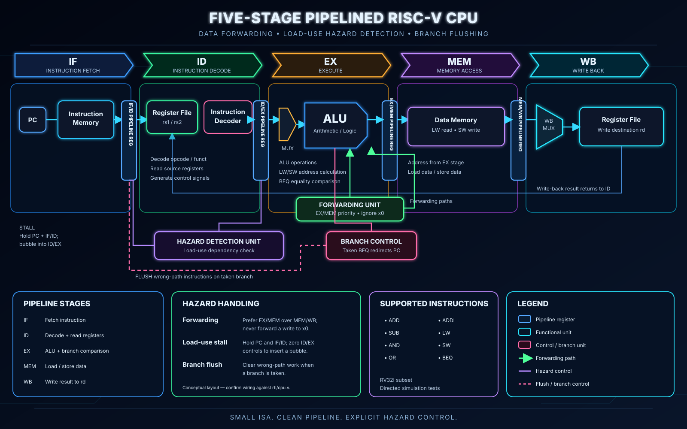

# Five-Stage Pipelined RISC-V CPU

A Verilog-based processor implementing a subset of RV32I, with data forwarding, load-use hazard detection, and branch flushing.


## Overview

This project implements a five-stage pipelined RISC-V processor in Verilog. It demonstrates instruction pipelining, data forwarding, load-use hazard detection, and control-hazard handling through branch flushing.

## Architecture



The processor follows the classic five-stage pipeline:

1. **IF — Instruction Fetch:** Fetches the instruction using the program counter.
2. **ID — Instruction Decode:** Decodes the instruction and reads the register file.
3. **EX — Execute:** Performs ALU operations and evaluates branch conditions.
4. **MEM — Memory Access:** Reads or writes data memory for load and store instructions.
5. **WB — Write Back:** Writes the selected result back to the register file.

Pipeline registers separate the stages. Forwarding paths help resolve data dependencies, while the hazard detection unit inserts a stall for a load-use dependency. Taken branches flush instructions that should not execute.

## Supported Instructions

| Instruction | Operation |
|---|---|
| `ADD` | Register addition |
| `SUB` | Register subtraction |
| `AND` | Bitwise AND |
| `OR` | Bitwise OR |
| `ADDI` | Add immediate |
| `LW` | Load word |
| `SW` | Store word |
| `BEQ` | Branch if equal |

This is an educational subset of RV32I, not a complete RISC-V implementation.

## Hazard Handling

- **EX/MEM forwarding:** Forwards the most recent available ALU result to dependent instructions.
- **MEM/WB forwarding:** Forwards a result from the write-back stage when needed.
- **Load-use detection:** Stalls the pipeline when a load result is not yet available to the following instruction.
- **Branch flushing:** Clears younger instructions when a branch is taken.

## Running the Tests

The test suite uses Icarus Verilog.

```bash
./scripts/run_tests.sh
```

The tests cover supported and unsupported decoder encodings, forwarding priority, hazard detection, and integrated CPU behavior.

The integrated test checks arithmetic, memory access, forwarding, a load-use stall, and a taken-branch flush.

## Project Structure

```text
.
├── rtl/
│   └── cpu.v
├── scripts/
│   └── run_tests.sh
├── docs/
│   └── architecture.svg
├── tests/
└── README.md
```

## Tools

- Verilog
- Icarus Verilog
- Git and GitHub

## Limitations

This project implements a limited instruction subset for learning and demonstration. It does not implement the full RV32I specification, interrupts, exceptions, caches, or a complete operating-system execution environment.

## Author

**Santhosh Srikumarany**
