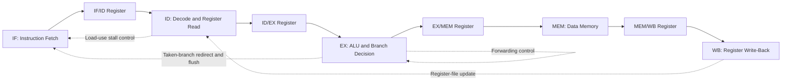

<div align="center">

# Five-Stage Pipelined RISC-V CPU

**A Verilog-based processor implementing a subset of RV32I, with data forwarding, load-use hazard detection, and branch flushing.**


</div>

## Overview

This project implements a five-stage pipelined RISC-V processor in Verilog, with SystemVerilog testbenches for verifying key datapath and control behaviors.

The design explores fundamental computer architecture concepts, including instruction decoding, pipeline registers, data forwarding, load-use stalls, memory operations, and control-hazard handling.

**Verification status:** All four current test suites pass, covering decoder behavior, forwarding selection, hazard detection, and integrated CPU execution. Verification is directed rather than exhaustive.

## Features

- Five-stage pipeline: Instruction Fetch (IF), Instruction Decode (ID), Execute (EX), Memory Access (MEM), and Write-Back (WB)
- Supported instructions:
  - Arithmetic and logical: `ADD`, `SUB`, `AND`, `OR`
  - Immediate arithmetic: `ADDI`
  - Memory access: `LW`, `SW`
  - Conditional branch: `BEQ`
- Data forwarding from pipeline stages to resolve operand dependencies
- Forwarding priority for the most recent available result
- Load-use hazard detection with pipeline stalling
- Taken-branch handling with wrong-path instruction flushing
- Register-file protection against writes to `x0`
- Directed unit tests and integrated CPU simulation
- VCD waveform generation for debugging and inspection
- Automated test execution using a shell script

## Architecture

The processor uses the classic five-stage pipeline organization.



The diagram is a conceptual overview. Refer to `rtl/cpu.v` for the implemented datapath, pipeline registers, and control logic.

### Pipeline hazard handling

**Data hazards:** The forwarding unit selects newer operand values from the EX/MEM or MEM/WB pipeline stages when required, reducing unnecessary stalls.

**Load-use hazards:** When an instruction depends on a value being loaded by the instruction immediately ahead of it, the hazard detection unit inserts a stall.

**Control hazards:** A taken `BEQ` redirects execution to the branch target and flushes the wrong-path instruction in the implemented pipeline.

## Repository Structure

```text
riscv-pipelined-cpu/
├── rtl/
│   └── cpu.v
├── tb/
│   ├── testbench.sv
│   ├── decoder_tb.sv
│   ├── forwarding_tb.sv
│   └── hazard_detection_tb.sv
├── docs/
│   └── waveforms/
├── scripts/
│   └── run_tests.sh
├── build/
├── .gitignore
└── README.md
```

Simulation executables are generated under `build/` by the test script. Generated simulation artifacts and waveform output are excluded from Git by `.gitignore`.

## Requirements

- Icarus Verilog with `iverilog` and `vvp`
- A terminal environment with the required tools available on `PATH`

On macOS with Homebrew:

```bash
brew install icarus-verilog
```

## Run the Tests

From the repository root, execute:

```bash
./scripts/run_tests.sh
```

The script compiles and runs four test suites:

| Test suite | Purpose |
|---|---|
| Decoder | Supported and unsupported instruction encodings |
| Forwarding unit | Forwarding selection, priority, and `x0` handling |
| Hazard detection unit | Load-use dependencies and stall conditions |
| Integrated CPU | Arithmetic, memory operations, forwarding, stalls, and branch flushing |

A successful run ends with:

```text
======================================
 ALL TEST SUITES PASSED
======================================
```

## Integrated CPU Test Results

The current directed program exercises arithmetic dependencies, a store/load sequence, a load-use hazard, and a taken branch.

Observed register and memory values:

| Location | Expected and observed value |
|---|---:|
| `x1` | 5 |
| `x2` | 7 |
| `x3` | 12 |
| `x4` | 12 |
| `x5` | 13 |
| `x6` | 13 |
| `x7` | 0 |
| `x8` | 42 |
| `mem[0]` | 12 |

The wrong-path instruction targeting `x7` is flushed, leaving `x7` at zero. The branch target instruction executes and writes 42 to `x8`.

Additional observations from the integrated test:

- EX/MEM forwarding observations: 4
- MEM/WB forwarding observations: 3
- Stall cycles observed: 1
- Flush cycles observed: 1

These forwarding counts represent observed forwarding selections during the test; they are not measures of exhaustive forwarding coverage.

## Waveform Inspection

The integrated testbench generates `cpu_top.vcd` in the current working directory.

To inspect the waveform, open it in a compatible viewer such as GTKWave:

```bash
gtkwave cpu_top.vcd
```

The waveform can help visualize the program counter, pipeline behavior, forwarding selections, stalls, and branch flushes. GTKWave is optional and must be installed separately.

## Scope and Limitations

- This is a processor implementing a limited RISC-V instruction subset, not a fully compliant RV32I implementation.
- Verification currently uses directed RTL simulation.
- Passing tests do not establish exhaustive functional correctness.
- Formal verification, FPGA implementation, timing closure, and physical hardware validation have not been established.
- Memory behavior and other implementation details are defined by the RTL and should not be assumed to model a complete hardware system.
- Unsupported instructions follow the behavior implemented by the decoder; the design should not be assumed to implement an illegal-instruction trap.

## Future Work

- Expand tests for `SUB`, `AND`, and `OR`.
- Add more operand combinations for forwarding and dependency handling.
- Test not-taken branches and additional control-hazard cases.
- Extend reset and edge-case verification.
- Add continuous integration to run the test suite automatically.

## License

No open-source license has been selected yet. Add a `LICENSE` file before distributing the project under an open-source license.
